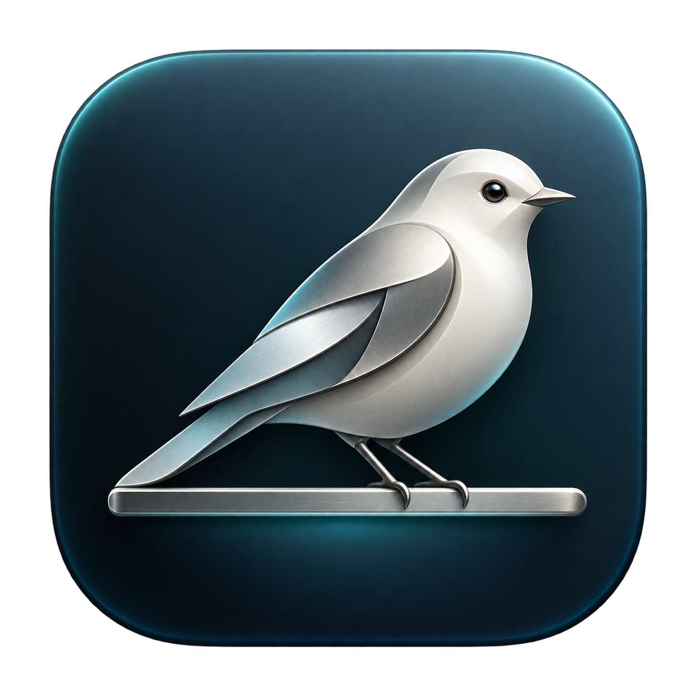

# Perch



A personal Intel Mac compatibility fork of [Vorssaint](https://github.com/vorssaint/vorssaint-utils).

**Vorssaint and its contributors built the original app and its features.** Perch adapts their work for Preetham Lokesh’s older Intel Mac. It is an unofficial fork, independently named and maintained, with no claim of endorsement. See [attribution](ATTRIBUTION.md), the original [trademark notice](TRADEMARKS.md), and the [GPL-3.0-or-later license](LICENSE).

## Why this fork exists

The original checkout built ARM-only executables. This fork adds Intel support and universal packaging so the app, fan helper, and Now Playing adapter can run natively on an Intel Mac. It also recognizes classic Intel CPU/GPU temperature sensors.

The many existing utilities—audio controls, window management, clipboard history, capture, system monitoring and more—come from the original project. Perch’s contribution is compatibility and the independent fork identity.

## Status and requirements

- macOS 14 Sonoma or newer; Intel or Apple Silicon.
- Locally validated on MacBookPro15,1 with macOS 15.8.2.
- Intel native and universal builds passed; original validation included 119,800 regression checks.
- Apple Silicon slices compile, but have not been run on Apple Silicon hardware in this fork.
- Features depend on hardware, firmware, permissions and macOS version. See [validation evidence](docs/INTEL-VALIDATION.md).
- This is a personal fork, with no promise of feature parity or ongoing support for every Mac.

## Build and install

Install Xcode Command Line Tools, then:

```sh
git clone https://github.com/preethaml7/vorssaint-utils.git
cd vorssaint-utils
./build.sh --dev
./build/PerchDeveloper --selftest
./build.sh --test
```

To install the separate developer app, use `./build.sh --dev --install`.
For an optimized universal build and DMG:

```sh
./build.sh
./build/Perch --selftest
./Tools/make-dmg.sh
```

For stable local signing and authenticated privileged fan control, run
`./Tools/setup-signing.sh` once before building. This creates Perch's own local
certificate, not an Apple Developer ID or notarization credential.

The outputs are `build/stage/Perch.app` and `dist/Perch-<version>.dmg`.
You can select `--arch=native`, `--arch=x86_64`, `--arch=arm64`, or
`--arch=universal`. Tests always run natively.

Perch uses `io.protopanda.perch`; developer builds use `io.protopanda.perch.dev`.
Its preferences and macOS permission grants are separate from Vorssaint. Installing
Perch does not grant permissions automatically or replace the original app.

## Releases

Only download Perch builds from [this fork’s releases](https://github.com/preethaml7/vorssaint-utils/releases). No Perch release has been published yet. Local and CI builds are not Apple-notarized unless a release explicitly says otherwise. Automatic self-installing updates are disabled; the update button opens this fork’s releases page.

The manual **Perch build and draft release** workflow builds universal artifacts.
An optional `perch-vX.Y.Z` tag creates a **draft prerelease** for review. It does
not publish a public release automatically. See [release instructions](docs/FORK-RELEASES.md).

## Contribute and follow along

If Intel compatibility helps you, [star this fork](https://github.com/preethaml7/vorssaint-utils) or report a reproducible problem with your Mac model, macOS version, and steps. Please also [star or support Vorssaint](https://github.com/vorssaint/vorssaint-utils)—the original authors deserve credit for the app.

Follow [CONTRIBUTING.md](CONTRIBUTING.md) and [the agent contribution guide](docs/AI-CONTRIBUTIONS.md). Keep changes focused and report what you actually tested. Please file fork-specific problems [here](https://github.com/preethaml7/vorssaint-utils/issues), rather than asking upstream to support a modified build.

Original project: [source](https://github.com/vorssaint/vorssaint-utils) · [website](https://vorssaint.com) · [support the original author](https://buymeacoffee.com/vorssaint).
